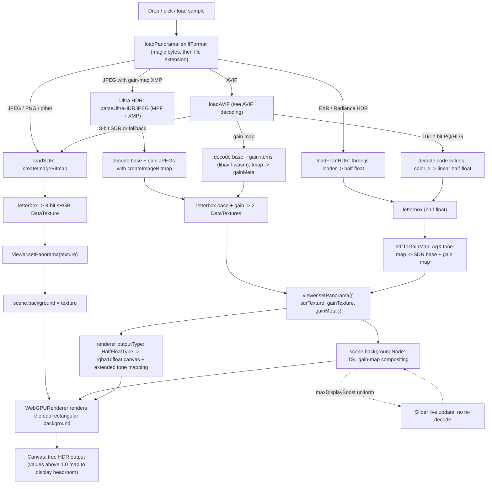
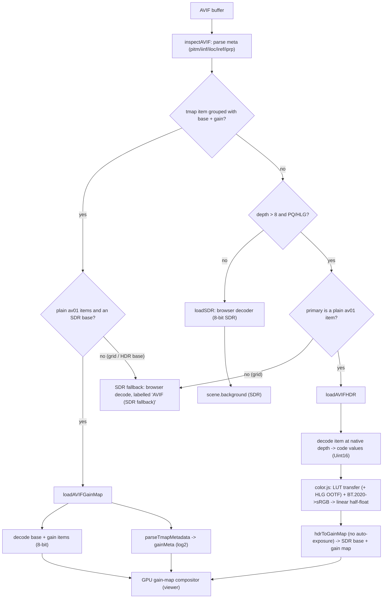

# Development & Architecture

Technical notes for the Panorama Viewer. For a quick overview and usage, see the [README](./README.md).

## Modules

| File | Responsibility |
| --- | --- |
| `src/main.js` | Wires everything together: UI, drag-drop, status/meta panels, the HDR-boost slider, and the responsive layout. |
| `src/loader.js` | Decodes a dropped file. Sniffs the format, validates aspect ratio, and for Ultra HDR parses the gain map in-house. |
| `src/avif.js` | AVIF container work: ISOBMFF/HEIF box parsing, standalone-item repackaging for the WASM decoder, and ISO 21496-1 `tmap` gain-map metadata parsing. |
| `src/color.js` | HDR transfer functions (PQ / HLG) and BT.2020 → sRGB gamut conversion for >8-bit AVIF. |
| `src/viewer.js` | `WebGPURenderer` setup, camera controls, SDR/HDR background rendering, and the live gain-map GPU compositing node. |
| `src/hdr.js` | Display-HDR detection and the WebGPU HDR canvas reconfiguration. |
| `src/minimap.js` | Equirectangular thumbnail with the real view frustum projected as the highlight. |

## Pipeline

Every format ends in one of two shapes: a single **SDR texture**, or an **SDR base texture + gain-map texture + metadata**. The viewer renders only those two. See [Formats: loading and display](#formats-loading-and-display) for the per-format details.



Aspect-ratio policy applies to every format: `< 2:1` is rejected (`AspectRatioError`), exactly `2:1` is used as-is, `> 2:1` is letterboxed onto a 2:1 buffer with black bars. The letterbox runs once, on a format-agnostic `PixelBuffer`, so SDR, Ultra HDR, AVIF and EXR/HDR behave identically.

## Rendering

`WebGPURenderer` (`three/webgpu`) renders the panorama as an **equirectangular background** (`scene.background` + equirectangular mapping) with the camera at the origin, shading each pixel from the camera ray direction. The background path is far more robust for large half-float HDR textures than mapping them onto a sphere material (which rendered black for 8K half-float textures on WebGPU).

Camera controls: pointer drag updates yaw/pitch (`lon`/`lat`); wheel and two-finger pinch change the camera FOV. Latitude is clamped to ±85° to avoid gimbal issues at the poles.

## Formats: loading and display

### Summary

| Format | Detected by | Decoder | What reaches the GPU | Render path | HDR boost slider |
| --- | --- | --- | --- | --- | --- |
| **JPG / PNG** | magic bytes | browser (`createImageBitmap`) | one 8-bit sRGB texture | `scene.background` | hidden |
| **AVIF, 8-bit SDR** | `ftyp` brand `avi*` | browser (`createImageBitmap`) | one 8-bit sRGB texture | `scene.background` | hidden |
| **AVIF, 10/12-bit PQ or HLG** | `ftyp` brand, then `pixi` depth + `colr` CICP | libavif-wasm | SDR base + gain map, **synthesised on load** | TSL gain-map node | shown |
| **AVIF with a gain map** | `ftyp` brand, then a `tmap` item | libavif-wasm (base and gain items) | SDR base + gain map **from the file** | TSL gain-map node | shown |
| **Ultra HDR JPG** | JPEG containing `hdrgm:` / `GContainer` / `Item:Semantic="GainMap"` in the first 256 KB | browser, on the two sub-images | SDR base + gain map **from the file** | TSL gain-map node | shown |
| **OpenEXR** (`.exr`) | magic `76 2F 31 01` (or the extension) | three.js `EXRLoader`, lazy-loaded | SDR base + gain map, **synthesised on load** | TSL gain-map node | shown |
| **Radiance HDR** (`.hdr`) | `#?RADIANCE` / `#?RGBE` (or the extension) | three.js `HDRLoader`, lazy-loaded | SDR base + gain map, **synthesised on load** | TSL gain-map node | shown |

"Synthesised" means the file only holds one HDR image, so `hdrToGainMap` builds the SDR base and the gain map from it (see [Converting between formats](#converting-between-formats)). "From the file" means both images already exist and are used as authored.

Detection trusts the **content**, not the file name; the extension is only a fallback for `.exr` / `.hdr` when the magic bytes are inconclusive.

### Display strategy

Whatever the format, the viewer shows one of two things.

**SDR image** (JPG, PNG, 8-bit AVIF)
- One `DataTexture` tagged `SRGBColorSpace`, assigned to `scene.background` with equirectangular mapping.
- Filtering is bilinear only: `DataTexture` carries no auto-generated mipmaps. That keeps every format on one code path.
- The HDR panel control is hidden and the META panel shows `SDR`.

**HDR image** (everything else)
- Two textures: the sRGB base (`SRGBColorSpace`, linearised by three on sampling) and the gain map (`LinearSRGBColorSpace`, a multiplier map, never colour-managed).
- A TSL node set as `scene.backgroundNode` recovers HDR per pixel, per frame, on the GPU (formula under [HDR recovery](#hdr-recovery-on-the-gpu)). The only live input is the `maxDisplayBoost` uniform, so the slider never triggers a re-decode.
- The output goes to the `rgba16float` canvas with extended tone mapping ([True HDR canvas](#true-hdr-canvas)), so values above 1.0 use the display's headroom.
- On a display without HDR, the same values are simply shown in the SDR range. The slider then starts at `1×`, because a higher value only clips highlights.

What the user sees at each boost value:

| Boost | Result |
| --- | --- |
| `1×` | the SDR base, unchanged |
| in between | the gain map applied partially, scaled by `weight` |
| `min(20×, capacity)` | the full HDR intent the file declares |

Other behaviour that applies to all formats:

- **Orientation.** Bitmap-based decoders return top-origin rows and set `flipY: true` on the `PixelBuffer`; EXR/HDR follow the three.js loader's own `texture.flipY`. The gain-map node computes its UV with `equirectUV(normalWorldGeometry)`, which matches what `scene.background` does, so both render paths show the same image at the same camera angle. Use `normalWorldGeometry`, not `normalWorld`: the background is drawn on a `BackSide` sphere, and `normalWorld` is flipped by the face direction, so it points away from the view ray. That rotated the panorama 180° horizontally and turned it upside down; an earlier `1 - v` flip hid only the vertical half. A wrong orientation shows up in one render path only (HDR formats, not JPG/PNG), so compare the same image through both paths when touching this code, e.g. `equirect.jpg` against `equirect.uhdr.jpg`, which share one base image.
- **Gain map resolution** may differ from the base (AVIF and Ultra HDR gain maps are often half size). Both are letterboxed independently to the same 2:1 target and sampled with the same UV, so they stay aligned.
- **Minimap thumbnail.** Always the 8-bit SDR base, at most 1024 px wide, so the HDR formats do not need a separate preview.
- **META panel.** `Format` names what was actually used, e.g. `AVIF (gain map)`, `AVIF 10-bit HDR (PQ)`, or `AVIF (SDR fallback)` when an HDR file had to be shown as SDR.
- **`?nohdr`.** Skips `enableHDR()` so the canvas stays SDR-tonemapped. A headless `rgba16float` canvas reads back near-black, so the tests use this to inspect the image.

## Converting between formats

There are two kinds of conversion: the ones the viewer does itself, and the ones you do beforehand with external tools to produce input files.

### Inside the viewer

All formats are first turned into a format-agnostic `PixelBuffer` (`data`, `width`, `height`, `kind: 'u8' | 'half'`, `flipY`), letterboxed once, and only then into textures.

```
JPG / PNG / 8-bit AVIF   -> PixelBuffer(u8)                    -> sRGB texture
Ultra HDR JPG            -> 2 x PixelBuffer(u8)                -> base + gain textures
AVIF with gain map       -> 2 x PixelBuffer(u8)                -> base + gain textures
10/12-bit PQ/HLG AVIF    -> codes -> PixelBuffer(half, linear) -> hdrToGainMap -> base + gain textures
OpenEXR / Radiance HDR   -> PixelBuffer(half, linear)          -> hdrToGainMap -> base + gain textures
```

**`hdrToGainMap`** (single HDR image to base + gain map), in `loader.js`:

1. One pass finds the peak value and the geometric-mean luminance.
2. `maxContentBoost = clamp(peak, 1.0001, 2^14)`; this becomes the gain map's range and the content's HDR capacity.
3. The SDR base is `AgX(hdr * exposure)`, quantised to 8-bit sRGB. AgX rolls highlights off with little hue shift.
4. The gain map is derived **from the quantised base**, so recovery is consistent with what is actually stored:

```
ratio = (hdr + 1/64) / (srgbToLinear(code) + 1/64)
gain  = round( min(1, log2(max(1, ratio)) / log2(maxContentBoost)) * 255 )
```

`exposure` depends on the source:

| Source | `exposure` | Why |
| --- | --- | --- |
| `.exr` / `.hdr` | `0.18 / geometricMean` (auto) | scene-referred, absolute scale is arbitrary |
| PQ / HLG AVIF | `1` | display-referred, SDR white is already 1.0; auto-exposure measurably darkened bright scenes |

Nothing is converted back: the viewer never writes a file. Display values are never stored, only the textures it needs.

### Producing input files with external tools

The commands below were run against this repository's samples. `avifenc`, `avifdec` and `avifgainmaputil` come with libavif (`brew install libavif`); `ffmpeg` is only needed for the float formats.

**Inspect a file**

```bash
avifdec --info file.avif                 # bit depth, CICP primaries / transfer / matrix
avifgainmaputil printmetadata file.avif  # gain-map headroom, min / max, offsets, gamma
avifgainmaputil extractgainmap file.avif gain.png
```

**Image to AVIF**

```bash
# 8-bit SDR
avifenc --depth 8 --yuv 420 in.png out.avif

# 10-bit HDR from a 16-bit PNG that already holds PQ / BT.2020 code values
avifenc --depth 10 --yuv 444 --cicp 9/16/9 --range full in.png out.avif   # PQ
avifenc --depth 10 --yuv 444 --cicp 9/18/9 --range full in.png out.avif   # HLG
avifenc --depth 12 --yuv 444 --cicp 9/16/9 --range full in.png out.avif   # 12-bit PQ
```

`--cicp P/T/M` is primaries / transfer / matrix: `9` is BT.2020, `16` is PQ, `18` is HLG. The viewer reads these tags, so a file without them is treated as sRGB.

**SDR + HDR to a gain-map AVIF**

```bash
avifgainmaputil combine sdr.png hdr_pq.png out.avif \
    --cicp-alternate 9/16/9 --downscaling 2 --ignore-profile
```

- The first image is the **base** (what viewers without gain-map support show), the second the **alternate**, the result of fully applying the gain map.
- `--downscaling 2` stores the gain map at half resolution; the viewer handles that.
- `combine` refuses a base that carries an ICC profile (`Computing gain maps for images with ICC profiles is not supported`). Export the base to a plain PNG first.

> **Check the declared headroom after `combine`.** `--max-headroom` defaults to 4 and caps the headroom written to the file, but the gain map itself is computed from the images. If the alternate is much brighter than 4 stops, `printmetadata` shows `Alternate headroom: 4` next to a `Gain Map Max` well above 4 (we saw 6.2). A viewer scales the gain by *display headroom / declared headroom*, so the image comes out several times too bright. Make the alternate image's real headroom match what is declared: either render it for the headroom you want (for a 4-stop file, the Ultra HDR original *at 4 stops*, not at full boost), or set `--max-headroom` to match.

**Ultra HDR JPG to another format**

- **To an SDR JPG** (lossless): the primary image is the SDR rendition. Take the bytes up to the primary's end (from the MPF directory), and drop the **MPF** `APP2` and the gain-map **XMP** `APP1` segments. Keep the entropy-coded scan byte-identical, so nothing is re-compressed. The segments must go: with `GContainer` / `hdrgm` left in, the viewer detects Ultra HDR and then fails to find the gain map.
- **To PNG**: decode that SDR JPEG and save the pixels (lossless relative to the JPEG, but an 8K PNG is about 22 MB).
- **To a 10-bit or gain-map AVIF**: `avifgainmaputil convert` reads Ultra HDR JPEGs directly, but needs a build with libxml2 (Homebrew's does not have it). Otherwise rebuild the HDR yourself: decode the base and the gain map, apply the recovery formula from [HDR recovery](#hdr-recovery-on-the-gpu) at the headroom you want to target, PQ-encode the result (BT.709 linear to BT.2020 first, SDR white = 203 nit), and feed that to `avifenc` or `combine`. Reconstructing at the file's *full* capacity (about 1000x here) overflows PQ's 10,000 nit ceiling, so pick a realistic target such as 4 stops.

**Float HDR sample files** (for testing the EXR / Radiance paths)

```bash
ffmpeg -f lavfi -i testsrc2=size=1024x512 -frames:v 1 -vf format=gbrpf32le -c:v exr sample.exr
ffmpeg -f lavfi -i testsrc2=size=1024x512 -frames:v 1 -vf format=gbrpf32le -c:v hdr sample.hdr
```

### Conversion cheat sheet

| From | To | How |
| --- | --- | --- |
| Ultra HDR JPG | SDR JPG | strip MPF + gain-map XMP, keep the scan data |
| SDR JPG | PNG | decode and save |
| PNG (PQ, 16-bit) | 10/12-bit AVIF | `avifenc --depth 10 --cicp 9/16/9` |
| SDR + HDR images | gain-map AVIF | `avifgainmaputil combine` |
| Ultra HDR JPG | gain-map AVIF | `avifgainmaputil convert` (needs libxml2), or rebuild the HDR and `combine` |
| gain-map AVIF | gain map as PNG | `avifgainmaputil extractgainmap` |
| EXR / Radiance HDR | anything the viewer shows | open it directly: `hdrToGainMap` builds the base and gain map |

### Known limitations

- **Gain-map parameters are per-file scalars.** An AVIF `tmap` can carry per-channel min / max / gamma / offsets; only channel 0 is used (the sample file has channel maxima of 3.28, 2.53 and 3.23), so highlights can be tinted slightly.
- **HDR base images are not supported.** A `tmap` whose base headroom exceeds its alternate headroom is shown as SDR (`AVIF (SDR fallback)`). The gain-map node assumes an SDR base.
- **Tiled HDR AVIF (`grid`) is not supported.** It is shown as SDR. Tiled SDR AVIF is fine: it goes through the browser decoder.
- **Only BT.709 / BT.2020 primaries are converted.** Display P3 AVIF (CICP primaries 12) is treated as sRGB, so it comes out slightly desaturated.
- **AVIF is recognised by its major brand.** `sniffFormat` calls a file AVIF when the `ftyp` major brand starts with `avi` (`avif`, `avis`). A file whose major brand is `mif1` with `avif` only among the compatible brands is classed as HEIF and decoded by the browser as 8-bit SDR, silently losing its HDR data. `avifenc` writes `avif` as the major brand, so files made with it are not affected.

## Ultra HDR decoding

Ultra HDR decoding does **not** use three.js's `UltraHDRLoader`, for two reasons:

1. **Parse failures.** Its JPEG segment scanner misreads the MPF offset on real-world files that carry an ICC `APP2` segment before the MPF `APP2` (e.g. produced by `@realsee/hdr-toolbox`), throwing `Invalid typed array length`.
2. **Hardcoded boost.** It hardcodes `maxDisplayBoost` to `sqrt(1.8 ^ HDRCapacityMax)` — roughly half the content's HDR capacity — which under-applies the gain map and leaves the image washed-out and flat.

Our implementation (`loader.js`):

1. Walks the JPEG marker segments honoring each segment length.
2. Reads the **MPF (`APP2` "MPF\0")** Multi-Picture Format directory to locate the **primary** and **gain-map** sub-images (`parseMPF`).
3. Reads the gain-map descriptor metadata (`GainMapMin/Max`, `Gamma`, `OffsetSDR/HDR`, `HDRCapacityMin/Max`) from the **gain-map sub-image's own `APP1` XMP** — this is a crucial detail: that metadata is **not** in the outer file's XMP, so the outer scan (which stops at the first SOS) never reaches it.
4. Uploads the SDR base image and the gain map as plain GPU textures (no CPU compositing).

### HDR recovery (on the GPU)

The gain map is composited on the GPU via a TSL `scene.backgroundNode`, per the Android / ISO 21496-1 recovery formula:

```
logRecovery = pow(gain, 1 / gamma)                              # per channel
logBoost    = mix(gainMapMin, gainMapMax, logRecovery)          # log2 units
weight      = clamp( (log2(maxDisplayBoost) - hdrCapacityMin)
                     / (hdrCapacityMax - hdrCapacityMin), 0, 1 )
hdr         = (sdrLinear + offsetSDR) * exp2(logBoost * weight) - offsetHDR
```

Because compositing happens per-frame on the GPU, **`maxDisplayBoost` is a uniform** exposed as a slider — adjusting it is instant, with no re-decode.

### maxDisplayBoost range

`maxDisplayBoost` is a **linear multiple of SDR white**, as in five-webgpu. The UI labels each value with its peak luminance in nits, assuming the BT.2408 reference white of 203 nit (`SDR_WHITE_NITS` in `main.js`).

| | Value | Meaning |
| --- | --- | --- |
| Slider minimum | `1×` | SDR white, 203 nit: the pure SDR rendition |
| Default, HDR display | `3×` | about 609 nit, close to the HDR600 peak (`DEFAULT_MAX_DISPLAY_BOOST`) |
| Default, SDR display | `1×` | highlights would only clip, so start from pure SDR |
| Slider maximum | `min(20×, content capacity)` | never beyond what the file declares (`SLIDER_MAX_DISPLAY_BOOST`) |

The value is converted to log2 (`setMaxDisplayBoost`) and fed to the `weight` term above, which scales the applied gain between `hdrCapacityMin` and `hdrCapacityMax`. This is how gain maps are meant to adapt to a display's headroom.

> Treating `HDRCapacityMax` (e.g. 9.97 for the sample Ultra HDR file) directly as a linear boost would give ~1000×, which is physically meaningless for any real display. The slider cap and the `weight` term are what keep the result sane.

## AVIF decoding (8-bit / 10-bit HDR / gain map)

The browser's `createImageBitmap` decodes every AVIF structure (grid, rotation,
alpha, ...) but only ever yields an **8-bit SDR** rendition: it discards the
extra precision of 10/12-bit HDR and silently ignores an embedded ISO 21496-1
gain map. So only the cases that need more than that go through **libavif
compiled to WebAssembly** (`@jsquash/avif`), with the container parsed in-house
(`src/avif.js`). Plain and 8-bit SDR AVIF stay on the browser decoder, like
JPG/PNG. The decoder WASM (≈340 KB gzipped) is **lazy-loaded** only when an HDR
AVIF is opened, as its own code-split chunk.

`loadAVIF` (`loader.js`) classifies the file and takes one of these paths:



### Repackaging image items for the decoder

Each image's bytes in the AVIF `mdat` are a **bare AV1 OBU stream**, not a full
AVIF file, so the WASM decoder can't consume them directly. `repackItemToAVIF`
wraps an item's payload in the smallest valid AVIF — `ftyp` + `meta`
(`hdlr`/`pitm`/`iinf`/`iprp`/`iloc`) + `mdat` — reusing the item's original
`av1C` / `ispe` / `pixi` property boxes verbatim so the decoder sees the exact
codec config and dimensions. This was verified **bit-exact** against libavif's
native decode of the same payload.

### Why not the bundled libavif for gain maps

`@jsquash/avif` bundles **libavif v1.0.1**, which predates the gain-map API
(added experimentally in v1.1.0, enabled by default in v1.2.0). So the WASM
decodes the AV1 image items, but the **container walk and `tmap` parsing are our
own** (`src/avif.js`). The gain-map metadata maps onto the same log2-space
`gainMeta` shape as the Ultra HDR JPEG path, so both render through the one GPU
compositor in `viewer.js`.

### 10/12-bit HDR colour

`@jsquash/avif` returns >8-bit output as raw code values (`Uint16Array`,
0..2^depth−1) in the file's transfer function and primaries — no tone mapping
applied. `color.js` turns those into scene-linear, sRGB-primary half-float:

- **Transfer**: evaluated through a per-code lookup table (a 10-bit image has
  only 1024 distinct values, so this takes an 8K conversion from ~3 s to
  ~0.35 s).
  - **PQ** (SMPTE ST 2084): EOTF to nits, divided by the 203-nit SDR reference
    white (BT.2408), so SDR white = 1.0.
  - **HLG** (ARIB STD-B67): inverse OETF to scene-linear, then the BT.2100 OOTF
    for a 1000-nit display (`Fd = 1000 · Ys^0.2 · Fs`, `Ys` = luminance in the
    file's primaries), divided by 203. Signal 0.75 (HLG diffuse white) maps to
    1.0. The OOTF scales all three channels by one luminance-derived factor, so
    hue is preserved.
- **Primaries**: a linear BT.2020 → sRGB (Rec.709) matrix; negative
  out-of-gamut values are clipped, highlights above 1.0 are kept. Other
  primaries (e.g. Display P3) are currently treated as sRGB.

The result feeds the existing `hdrToGainMap`, so 10-bit AVIF renders through the
same SDR-base + gain-map pipeline as `.exr` / `.hdr`, with one difference:
`.exr` / `.hdr` are scene-referred (arbitrary absolute scale), so `hdrToGainMap`
auto-exposes them to middle grey. PQ / HLG are display-referred (SDR white is
already 1.0), so AVIF passes `autoExposure: false`. Auto-exposing them darkened
bright scenes (a measured factor of 0.44 on the sample panorama).

### Fallbacks

The WASM path only understands plain `av01` image items. HDR files built from
`grid` (tiled) items, or any WASM decode failure, fall back to the browser's
SDR rendition and are labelled `AVIF (SDR fallback)` in the format field so the
downgrade is visible.

## True HDR canvas

We create the `WebGPURenderer` with `outputType: HalfFloatType`. Since three r171+ this makes the renderer configure the WebGPU canvas natively for HDR: the preferred canvas format becomes `rgba16float` and the context tone mapping is set to `"extended"`. Pixels above the SDR white point (`> 1.0`) then map into the display's HDR headroom instead of being clamped. For SDR content (values ≤ 1.0) it's a no-op, so the half-float canvas is used unconditionally.

```js
new WebGPURenderer({ canvas, antialias: true, outputType: HalfFloatType })
```

> Earlier versions (r169) did not do this, so this project used to reconfigure the `GPUCanvasContext` manually. That hack now **conflicts** with r171+: three re-`configure()`s the context on `setSize()` and, without `outputType: HalfFloatType`, resets tone mapping to `standard` — which clamps highlights and silently kills the HDR effect. Using the native `outputType` option is the correct, conflict-free approach.

If the display isn't HDR-capable, extended tone mapping simply presents the SDR range (the status badge reports the display capability).

## Minimap frustum projection

The visible region of a perspective camera is **not** a rectangle on an equirectangular map — straight screen edges become curves that bow strongly near the poles. The minimap:

- Samples points along the four screen-rectangle edges, turns each into a world ray via the camera basis, converts to lon/lat → map pixels, and draws the resulting polygon (replicated at ±W for horizontal wraparound).
- Detects when a pole (zenith/nadir) is **inside** the frustum and, in that case, builds a full-width **pole cap** from the per-longitude latitude extent — the simple perimeter polygon can't represent a region that wraps all 360° of longitude up to the pole.

## Single three.js instance

`three/webgpu` is a standalone bundle that includes its own copy of three.js core, so mixing it with bare-`three` core imports would load two copies ("Multiple instances of Three.js" + broken `instanceof`). To keep a single instance:

- Import the renderer **and** core classes from `three/webgpu`, and the TSL node functions (`texture`, `uniform`, `equirectUV`, `Fn`, …) from `three/tsl` (they moved out of `three/webgpu` in three r171+). Our code never imports bare `three`.
- `vite.config.js` sets `resolve.dedupe: ['three']` so the bare `three` that `three/tsl` imports internally resolves to the same core.

## Build & deploy

- `base: './'` (relative asset URLs) so the build works from any GitHub Pages project subpath.
- `LICENSE`, `NOTICE` and `THIRD_PARTY_NOTICES.txt` live only at the repository root. A small Vite plugin in `vite.config.js` emits them into the root of `dist/` at build time (and serves them from the dev server at the same URLs), so there are no duplicate copies under `public/`. `THIRD_PARTY_NOTICES.txt` reproduces the upstream license texts verbatim (three.js, @jsquash/avif, libavif, libaom); when a bundled dependency changes, update it from that dependency's own license file.
- `.github/workflows/deploy.yml` builds and publishes `dist/` to GitHub Pages on push to `main`.

## Tests

Headless-Chrome smoke tests drive the production preview build with WebGPU enabled:

```bash
npm run build && npm run preview   # in one terminal
npm test            # aspect-ratio handling, SDR render, drag + minimap click
npm run test:mobile # modal minimap + FOV zoom
npm run test:uhdr   # Ultra HDR decode, true-HDR path, boost control
npm run test:avif   # AVIF 8-bit SDR, 10-bit PQ HDR, and gain-map decode
```

> The AVIF test fixtures (`test/fixtures/avif_*.avif`) are generated with
> libavif's `avifenc` / `avifgainmaputil`; `test/run-all.sh` boots the preview
> and runs the smoke, uhdr and avif suites in one go.

> Note: a headless `rgba16float` canvas reads back near-black in screenshots, so the tests use a `?nohdr` flag to verify rendering in the SDR-tonemapped path, and inspect decoded texture stats directly for the HDR path.
