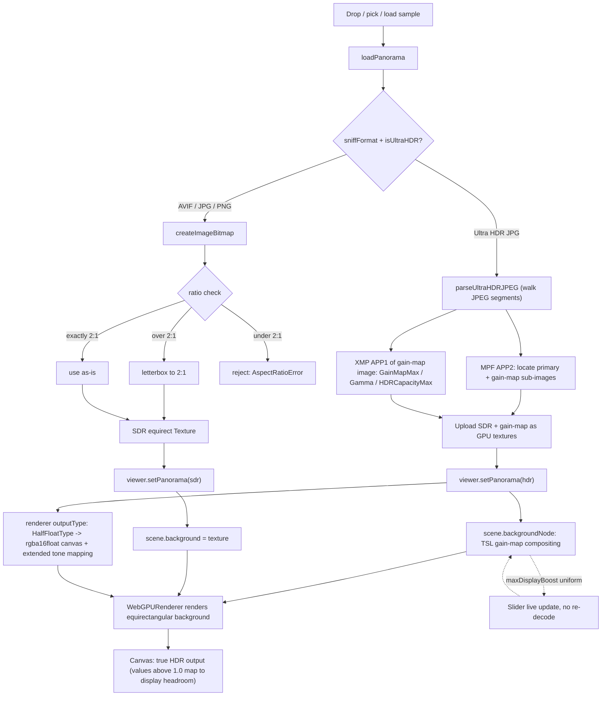

# Development & Architecture

Technical notes for the Panorama Viewer. For a quick overview and usage, see the [README](./README.md).

## Modules

| File | Responsibility |
| --- | --- |
| `src/main.js` | Wires everything together: UI, drag-drop, status/meta panels, the HDR-boost slider, and the responsive layout. |
| `src/loader.js` | Decodes a dropped file. Sniffs the format, validates aspect ratio, and for Ultra HDR parses the gain map in-house. |
| `src/viewer.js` | `WebGPURenderer` setup, camera controls, SDR/HDR background rendering, and the live gain-map GPU compositing node. |
| `src/hdr.js` | Display-HDR detection and the WebGPU HDR canvas reconfiguration. |
| `src/minimap.js` | Equirectangular thumbnail with the real view frustum projected as the highlight. |

## Pipeline



## Rendering

`WebGPURenderer` (`three/webgpu`) renders the panorama as an **equirectangular background** (`scene.background` + equirectangular mapping) with the camera at the origin, shading each pixel from the camera ray direction. The background path is far more robust for large half-float HDR textures than mapping them onto a sphere material (which rendered black for 8K half-float textures on WebGPU).

Camera controls: pointer drag updates yaw/pitch (`lon`/`lat`); wheel and two-finger pinch change the camera FOV. Latitude is clamped to ±85° to avoid gimbal issues at the poles.

## Ultra HDR decoding

Ultra HDR decoding does **not** use three.js's `UltraHDRLoader`, for two reasons:

1. **Parse failures.** Its JPEG segment scanner misreads the MPF offset on real-world files that carry an ICC `APP2` segment before the MPF `APP2` (e.g. produced by `@realsee/hdr-toolbox`), throwing `Invalid typed array length`.
2. **Hardcoded boost.** It hardcodes `maxDisplayBoost` to `sqrt(1.8 ^ HDRCapacityMax)` — roughly half the content's HDR capacity — which under-applies the gain map and leaves the image washed-out and flat.

Our implementation (`loader.js`):

1. Walks the JPEG marker segments honoring each segment length.
2. Reads the **MPF (`APP2` "MPF\0")** Multi-Picture Format directory to locate the **primary** and **gain-map** sub-images (`parseMPF`).
3. Reads the gain-map descriptor metadata (`GainMapMin/Max`, `Gamma`, `OffsetSDR/HDR`, `HDRCapacityMin/Max`) from the **gain-map sub-image's own `APP1` XMP** — this is a crucial detail: that metadata is **not** in the outer file's XMP, so the outer scan (which stops at the first SOS) never reaches it.
4. Uploads the SDR base image and the gain map as plain GPU textures (no CPU compositing).

### HDR recovery (on the GPU)

The gain map is composited on the GPU via a TSL `scene.backgroundNode`, per the Android / ISO 21496-1 recovery formula:

```
logRecovery = pow(gain, 1 / gamma)                              # per channel
logBoost    = mix(gainMapMin, gainMapMax, logRecovery)          # log2 units
weight      = clamp( (log2(maxDisplayBoost) - hdrCapacityMin)
                     / (hdrCapacityMax - hdrCapacityMin), 0, 1 )
hdr         = (sdrLinear + offsetSDR) * exp2(logBoost * weight) - offsetHDR
```

Because compositing happens per-frame on the GPU, **`maxDisplayBoost` is a uniform** exposed as a slider — adjusting it is instant, with no re-decode.

### maxDisplayBoost range

HDR headroom is measured in **stops** (log2). Real HDR displays offer only ~1.5–4 stops over SDR white (a great display such as a modern MacBook Pro ≈ 4 stops / 16×). So the slider is capped at **4 stops (16×)** regardless of the (often very large) `HDRCapacityMax` the file declares, and defaults to a strong-but-sane **3 stops (8×)**. The `weight` term then adapts the applied gain to the chosen display headroom — exactly how gain maps are meant to scale across displays.

> Treating `HDRCapacityMax` (e.g. 9.97) directly as a linear boost would give ~1000×, which is physically meaningless for any real display.

## True HDR canvas

We create the `WebGPURenderer` with `outputType: HalfFloatType`. Since three r171+ this makes the renderer configure the WebGPU canvas natively for HDR: the preferred canvas format becomes `rgba16float` and the context tone mapping is set to `"extended"`. Pixels above the SDR white point (`> 1.0`) then map into the display's HDR headroom instead of being clamped. For SDR content (values ≤ 1.0) it's a no-op, so the half-float canvas is used unconditionally.

```js
new WebGPURenderer({ canvas, antialias: true, outputType: HalfFloatType })
```

> Earlier versions (r169) did not do this, so this project used to reconfigure the `GPUCanvasContext` manually. That hack now **conflicts** with r171+: three re-`configure()`s the context on `setSize()` and, without `outputType: HalfFloatType`, resets tone mapping to `standard` — which clamps highlights and silently kills the HDR effect. Using the native `outputType` option is the correct, conflict-free approach.

If the display isn't HDR-capable, extended tone mapping simply presents the SDR range (the status badge reports the display capability).

## Minimap frustum projection

The visible region of a perspective camera is **not** a rectangle on an equirectangular map — straight screen edges become curves that bow strongly near the poles. The minimap:

- Samples points along the four screen-rectangle edges, turns each into a world ray via the camera basis, converts to lon/lat → map pixels, and draws the resulting polygon (replicated at ±W for horizontal wraparound).
- Detects when a pole (zenith/nadir) is **inside** the frustum and, in that case, builds a full-width **pole cap** from the per-longitude latitude extent — the simple perimeter polygon can't represent a region that wraps all 360° of longitude up to the pole.

## Single three.js instance

`three/webgpu` is a standalone bundle that includes its own copy of three.js core, so mixing it with bare-`three` core imports would load two copies ("Multiple instances of Three.js" + broken `instanceof`). To keep a single instance:

- Import the renderer **and** core classes from `three/webgpu`, and the TSL node functions (`texture`, `uniform`, `equirectUV`, `Fn`, …) from `three/tsl` (they moved out of `three/webgpu` in three r171+). Our code never imports bare `three`.
- `vite.config.js` sets `resolve.dedupe: ['three']` so the bare `three` that `three/tsl` imports internally resolves to the same core.

## Build & deploy

- `base: './'` (relative asset URLs) so the build works from any GitHub Pages project subpath.
- `.github/workflows/deploy.yml` builds and publishes `dist/` to GitHub Pages on push to `main`.

## Tests

Headless-Chrome smoke tests drive the production preview build with WebGPU enabled:

```bash
npm run build && npm run preview   # in one terminal
npm test            # aspect-ratio handling, SDR render, drag + minimap click
npm run test:mobile # modal minimap + FOV zoom
npm run test:uhdr   # Ultra HDR decode, true-HDR path, boost control
```

> Note: a headless `rgba16float` canvas reads back near-black in screenshots, so the tests use a `?nohdr` flag to verify rendering in the SDR-tonemapped path, and inspect decoded texture stats directly for the HDR path.
