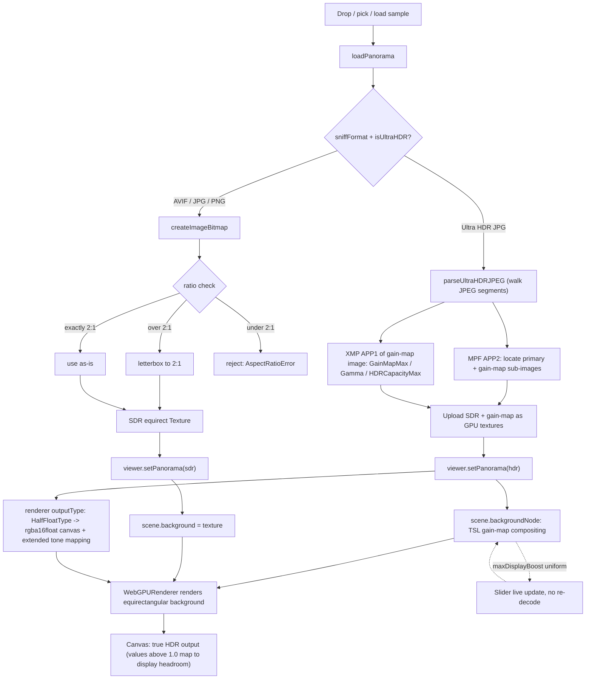
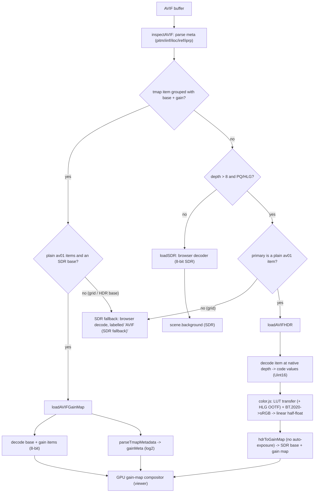

# Development & Architecture

Technical notes for the Panorama Viewer. For a quick overview and usage, see the [README](./README.md).

## Modules

| File | Responsibility |
| --- | --- |
| `src/main.js` | Wires everything together: UI, drag-drop, status/meta panels, the HDR-boost slider, and the responsive layout. |
| `src/loader.js` | Decodes a dropped file. Sniffs the format, validates aspect ratio, and for Ultra HDR parses the gain map in-house. |
| `src/avif.js` | AVIF container work: ISOBMFF/HEIF box parsing, standalone-item repackaging for the WASM decoder, and ISO 21496-1 `tmap` gain-map metadata parsing. |
| `src/color.js` | HDR transfer functions (PQ / HLG) and BT.2020 → sRGB gamut conversion for >8-bit AVIF. |
| `src/viewer.js` | `WebGPURenderer` setup, camera controls, SDR/HDR background rendering, and the live gain-map GPU compositing node. |
| `src/hdr.js` | Display-HDR detection and the WebGPU HDR canvas reconfiguration. |
| `src/minimap.js` | Equirectangular thumbnail with the real view frustum projected as the highlight. |

## Pipeline



## Rendering

`WebGPURenderer` (`three/webgpu`) renders the panorama as an **equirectangular background** (`scene.background` + equirectangular mapping) with the camera at the origin, shading each pixel from the camera ray direction. The background path is far more robust for large half-float HDR textures than mapping them onto a sphere material (which rendered black for 8K half-float textures on WebGPU).

Camera controls: pointer drag updates yaw/pitch (`lon`/`lat`); wheel and two-finger pinch change the camera FOV. Latitude is clamped to ±85° to avoid gimbal issues at the poles.

## Ultra HDR decoding

Ultra HDR decoding does **not** use three.js's `UltraHDRLoader`, for two reasons:

1. **Parse failures.** Its JPEG segment scanner misreads the MPF offset on real-world files that carry an ICC `APP2` segment before the MPF `APP2` (e.g. produced by `@realsee/hdr-toolbox`), throwing `Invalid typed array length`.
2. **Hardcoded boost.** It hardcodes `maxDisplayBoost` to `sqrt(1.8 ^ HDRCapacityMax)` — roughly half the content's HDR capacity — which under-applies the gain map and leaves the image washed-out and flat.

Our implementation (`loader.js`):

1. Walks the JPEG marker segments honoring each segment length.
2. Reads the **MPF (`APP2` "MPF\0")** Multi-Picture Format directory to locate the **primary** and **gain-map** sub-images (`parseMPF`).
3. Reads the gain-map descriptor metadata (`GainMapMin/Max`, `Gamma`, `OffsetSDR/HDR`, `HDRCapacityMin/Max`) from the **gain-map sub-image's own `APP1` XMP** — this is a crucial detail: that metadata is **not** in the outer file's XMP, so the outer scan (which stops at the first SOS) never reaches it.
4. Uploads the SDR base image and the gain map as plain GPU textures (no CPU compositing).

### HDR recovery (on the GPU)

The gain map is composited on the GPU via a TSL `scene.backgroundNode`, per the Android / ISO 21496-1 recovery formula:

```
logRecovery = pow(gain, 1 / gamma)                              # per channel
logBoost    = mix(gainMapMin, gainMapMax, logRecovery)          # log2 units
weight      = clamp( (log2(maxDisplayBoost) - hdrCapacityMin)
                     / (hdrCapacityMax - hdrCapacityMin), 0, 1 )
hdr         = (sdrLinear + offsetSDR) * exp2(logBoost * weight) - offsetHDR
```

Because compositing happens per-frame on the GPU, **`maxDisplayBoost` is a uniform** exposed as a slider — adjusting it is instant, with no re-decode.

### maxDisplayBoost range

HDR headroom is measured in **stops** (log2). Real HDR displays offer only ~1.5–4 stops over SDR white (a great display such as a modern MacBook Pro ≈ 4 stops / 16×). So the slider is capped at **4 stops (16×)** regardless of the (often very large) `HDRCapacityMax` the file declares, and defaults to a strong-but-sane **3 stops (8×)**. The `weight` term then adapts the applied gain to the chosen display headroom — exactly how gain maps are meant to scale across displays.

> Treating `HDRCapacityMax` (e.g. 9.97) directly as a linear boost would give ~1000×, which is physically meaningless for any real display.

## AVIF decoding (8-bit / 10-bit HDR / gain map)

The browser's `createImageBitmap` decodes every AVIF structure (grid, rotation,
alpha, ...) but only ever yields an **8-bit SDR** rendition: it discards the
extra precision of 10/12-bit HDR and silently ignores an embedded ISO 21496-1
gain map. So only the cases that need more than that go through **libavif
compiled to WebAssembly** (`@jsquash/avif`), with the container parsed in-house
(`src/avif.js`). Plain and 8-bit SDR AVIF stay on the browser decoder, like
JPG/PNG. The decoder WASM (≈340 KB gzipped) is **lazy-loaded** only when an HDR
AVIF is opened, as its own code-split chunk.

`loadAVIF` (`loader.js`) classifies the file and takes one of these paths:



### Repackaging image items for the decoder

Each image's bytes in the AVIF `mdat` are a **bare AV1 OBU stream**, not a full
AVIF file, so the WASM decoder can't consume them directly. `repackItemToAVIF`
wraps an item's payload in the smallest valid AVIF — `ftyp` + `meta`
(`hdlr`/`pitm`/`iinf`/`iprp`/`iloc`) + `mdat` — reusing the item's original
`av1C` / `ispe` / `pixi` property boxes verbatim so the decoder sees the exact
codec config and dimensions. This was verified **bit-exact** against libavif's
native decode of the same payload.

### Why not the bundled libavif for gain maps

`@jsquash/avif` bundles **libavif v1.0.1**, which predates the gain-map API
(added experimentally in v1.1.0, enabled by default in v1.2.0). So the WASM
decodes the AV1 image items, but the **container walk and `tmap` parsing are our
own** (`src/avif.js`). The gain-map metadata maps onto the same log2-space
`gainMeta` shape as the Ultra HDR JPEG path, so both render through the one GPU
compositor in `viewer.js`.

### 10/12-bit HDR colour

`@jsquash/avif` returns >8-bit output as raw code values (`Uint16Array`,
0..2^depth−1) in the file's transfer function and primaries — no tone mapping
applied. `color.js` turns those into scene-linear, sRGB-primary half-float:

- **Transfer**: evaluated through a per-code lookup table (a 10-bit image has
  only 1024 distinct values, so this takes an 8K conversion from ~3 s to
  ~0.35 s).
  - **PQ** (SMPTE ST 2084): EOTF to nits, divided by the 203-nit SDR reference
    white (BT.2408), so SDR white = 1.0.
  - **HLG** (ARIB STD-B67): inverse OETF to scene-linear, then the BT.2100 OOTF
    for a 1000-nit display (`Fd = 1000 · Ys^0.2 · Fs`, `Ys` = luminance in the
    file's primaries), divided by 203. Signal 0.75 (HLG diffuse white) maps to
    1.0. The OOTF scales all three channels by one luminance-derived factor, so
    hue is preserved.
- **Primaries**: a linear BT.2020 → sRGB (Rec.709) matrix; negative
  out-of-gamut values are clipped, highlights above 1.0 are kept. Other
  primaries (e.g. Display P3) are currently treated as sRGB.

The result feeds the existing `hdrToGainMap`, so 10-bit AVIF renders through the
same SDR-base + gain-map pipeline as `.exr` / `.hdr`, with one difference:
`.exr` / `.hdr` are scene-referred (arbitrary absolute scale), so `hdrToGainMap`
auto-exposes them to middle grey. PQ / HLG are display-referred (SDR white is
already 1.0), so AVIF passes `autoExposure: false`. Auto-exposing them darkened
bright scenes (a measured factor of 0.44 on the sample panorama).

### Fallbacks

The WASM path only understands plain `av01` image items. HDR files built from
`grid` (tiled) items, or any WASM decode failure, fall back to the browser's
SDR rendition and are labelled `AVIF (SDR fallback)` in the format field so the
downgrade is visible.

## True HDR canvas

We create the `WebGPURenderer` with `outputType: HalfFloatType`. Since three r171+ this makes the renderer configure the WebGPU canvas natively for HDR: the preferred canvas format becomes `rgba16float` and the context tone mapping is set to `"extended"`. Pixels above the SDR white point (`> 1.0`) then map into the display's HDR headroom instead of being clamped. For SDR content (values ≤ 1.0) it's a no-op, so the half-float canvas is used unconditionally.

```js
new WebGPURenderer({ canvas, antialias: true, outputType: HalfFloatType })
```

> Earlier versions (r169) did not do this, so this project used to reconfigure the `GPUCanvasContext` manually. That hack now **conflicts** with r171+: three re-`configure()`s the context on `setSize()` and, without `outputType: HalfFloatType`, resets tone mapping to `standard` — which clamps highlights and silently kills the HDR effect. Using the native `outputType` option is the correct, conflict-free approach.

If the display isn't HDR-capable, extended tone mapping simply presents the SDR range (the status badge reports the display capability).

## Minimap frustum projection

The visible region of a perspective camera is **not** a rectangle on an equirectangular map — straight screen edges become curves that bow strongly near the poles. The minimap:

- Samples points along the four screen-rectangle edges, turns each into a world ray via the camera basis, converts to lon/lat → map pixels, and draws the resulting polygon (replicated at ±W for horizontal wraparound).
- Detects when a pole (zenith/nadir) is **inside** the frustum and, in that case, builds a full-width **pole cap** from the per-longitude latitude extent — the simple perimeter polygon can't represent a region that wraps all 360° of longitude up to the pole.

## Single three.js instance

`three/webgpu` is a standalone bundle that includes its own copy of three.js core, so mixing it with bare-`three` core imports would load two copies ("Multiple instances of Three.js" + broken `instanceof`). To keep a single instance:

- Import the renderer **and** core classes from `three/webgpu`, and the TSL node functions (`texture`, `uniform`, `equirectUV`, `Fn`, …) from `three/tsl` (they moved out of `three/webgpu` in three r171+). Our code never imports bare `three`.
- `vite.config.js` sets `resolve.dedupe: ['three']` so the bare `three` that `three/tsl` imports internally resolves to the same core.

## Build & deploy

- `base: './'` (relative asset URLs) so the build works from any GitHub Pages project subpath.
- `LICENSE`, `NOTICE` and `THIRD_PARTY_NOTICES.txt` live only at the repository root. A small Vite plugin in `vite.config.js` emits them into the root of `dist/` at build time (and serves them from the dev server at the same URLs), so there are no duplicate copies under `public/`. `THIRD_PARTY_NOTICES.txt` reproduces the upstream license texts verbatim (three.js, @jsquash/avif, libavif, libaom); when a bundled dependency changes, update it from that dependency's own license file.
- `.github/workflows/deploy.yml` builds and publishes `dist/` to GitHub Pages on push to `main`.

## Tests

Headless-Chrome smoke tests drive the production preview build with WebGPU enabled:

```bash
npm run build && npm run preview   # in one terminal
npm test            # aspect-ratio handling, SDR render, drag + minimap click
npm run test:mobile # modal minimap + FOV zoom
npm run test:uhdr   # Ultra HDR decode, true-HDR path, boost control
npm run test:avif   # AVIF 8-bit SDR, 10-bit PQ HDR, and gain-map decode
```

> The AVIF test fixtures (`test/fixtures/avif_*.avif`) are generated with
> libavif's `avifenc` / `avifgainmaputil`; `test/run-all.sh` boots the preview
> and runs the smoke, uhdr and avif suites in one go.

> Note: a headless `rgba16float` canvas reads back near-black in screenshots, so the tests use a `?nohdr` flag to verify rendering in the SDR-tonemapped path, and inspect decoded texture stats directly for the HDR path.
